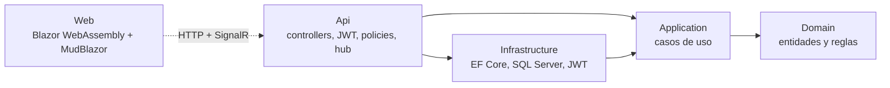

# Tickecheck

<!-- Reemplazá <usuario> por tu usuario de GitHub cuando subas el repositorio. -->
[](https://github.com/<usuario>/Tickecheck/actions/workflows/ci.yml)


Sistema de tickets (helpdesk) **multi-tenant**: varias empresas usan la misma instalación y cada
una ve únicamente sus datos. Hecho con .NET 9, Clean Architecture, EF Core, SignalR y Blazor
WebAssembly.

Es un proyecto de portfolio pensado para poder leerse y explicarse: cada decisión importante
tiene su registro en [docs/decisions](docs/decisions) y hay una [guía de estudio](docs/STUDY.md).

**Demo:** no hay una instancia pública. La aplicación completa se levanta en local con un solo
comando de Docker (ver [Cómo correrlo](#cómo-correrlo)). El deploy en Azure está automatizado y
documentado en [docs/DEPLOY.md](docs/DEPLOY.md), pero no fue ejecutado.

## Qué hace

- Alta de empresas (SuperAdmin) y de usuarios y categorías (TenantAdmin).
- Login con JWT de 15 minutos y refresh tokens con rotación y detección de reuso.
- Tickets con filtros, paginación y ordenamiento.
- Asignación y cambios de estado con reglas de negocio en el dominio.
- Comentarios públicos e internos (los internos nunca llegan al solicitante).
- SLA por prioridad y marca de tickets vencidos.
- Historial de auditoría de cada cambio de estado, asignación y prioridad.
- Notificaciones en tiempo real con SignalR, aisladas por empresa.
- Dashboard con estadísticas por empresa.

| Rol | Alcance |
|---|---|
| SuperAdmin | Administra empresas. No accede a los tickets de ninguna. |
| TenantAdmin | Todo dentro de su empresa: usuarios, categorías, borrar tickets. |
| Agent | Atiende tickets: asigna, cambia estado y prioridad, comenta, ve el dashboard. |
| Requester | Crea tickets y ve solo los suyos. Puede comentar y reabrir. |

## Arquitectura



Las dependencias apuntan solo hacia el dominio. El aislamiento entre empresas se aplica en un
único lugar (`AppDbContext`): un filtro global en todas las lecturas y una validación en todos los
guardados. El detalle, con el recorrido de una request completa, está en
[docs/ARCHITECTURE.md](docs/ARCHITECTURE.md).

```
src/
  Tickecheck.Domain/          entidades, máquina de estados, SLA
  Tickecheck.Application/     un archivo por caso de uso (comando + validador + handler)
  Tickecheck.Infrastructure/  EF Core, migraciones, repositorios, JWT, datos de demo
  Tickecheck.Api/             controllers, autenticación, errores, SignalR
  Tickecheck.Web/             frontend Blazor
tests/
  Tickecheck.Domain.Tests/        reglas de negocio
  Tickecheck.Application.Tests/   casos de uso con Moq
  Tickecheck.IntegrationTests/    API + SQL Server real (Testcontainers)
docs/                         arquitectura, decisiones, guía de estudio, deploy
```

## Cómo correrlo

Requisitos: [.NET SDK 9](https://dotnet.microsoft.com/download) y Docker Desktop.

Primero, creá el archivo de variables locales:

```bash
cp .env.example .env
```

### Opción A — Todo en Docker

```bash
docker compose up -d --build
```

Abrí http://localhost:8080.

### Opción B — Base en Docker, API desde el código

Es la opción cómoda para desarrollar y depurar.

```bash
docker compose up -d sqlserver
dotnet run --project src/Tickecheck.Api --launch-profile http
```

Abrí http://localhost:5127.

En ambos casos, al arrancar la API aplica las migraciones y carga los datos de demo.

### Cuentas de demo

Todas usan la contraseña `Demo123!`.

| Email | Rol | Empresa |
|---|---|---|
| `superadmin@tickecheck.demo` | SuperAdmin | — |
| `admin@acme.demo` | TenantAdmin | Acme Corp |
| `agent1@acme.demo`, `agent2@acme.demo` | Agent | Acme Corp |
| `user1@acme.demo`, `user2@acme.demo` | Requester | Acme Corp |
| `admin@globex.demo` | TenantAdmin | Globex Inc |
| `agent1@globex.demo`, `agent2@globex.demo` | Agent | Globex Inc |
| `user1@globex.demo`, `user2@globex.demo` | Requester | Globex Inc |

Para ver el aislamiento y el tiempo real: abrí dos navegadores (o uno normal y uno privado),
entrá como `agent1@acme.demo` en uno y `user1@acme.demo` en el otro, y comentá un ticket.

## Tests y cobertura

```bash
dotnet test
```

Los tests de integración necesitan Docker corriendo: levantan su propio SQL Server.

| Proyecto | Tests | Qué cubre |
|---|---|---|
| Domain.Tests | 53 | Transiciones de estado, SLA, auditoría |
| Application.Tests | 60 | Casos de uso con dependencias simuladas |
| IntegrationTests | 55 | Aislamiento entre empresas, roles, flujo de tickets, SignalR |

Cobertura del backend: **97 % de líneas, 84 % de ramas** (Domain, Application, Infrastructure y
Api; se excluyen las migraciones generadas). El frontend no tiene tests automáticos y no entra en
el número. El workflow de CI falla si la cobertura de líneas baja del 70 %, y publica el reporte
en el resumen de cada ejecución. El badge de arriba es estático: se actualiza a mano.

Para generar el reporte local:

```bash
dotnet tool restore
dotnet test --settings coverlet.runsettings --collect:"XPlat Code Coverage" --results-directory TestResults
dotnet reportgenerator "-reports:TestResults/**/coverage.cobertura.xml" "-targetdir:coverage" "-reporttypes:Html"
```

## Documentación

- [Arquitectura](docs/ARCHITECTURE.md): capas, una request de punta a punta, multi-tenancy.
- [Decisiones](docs/decisions): un ADR por decisión, con las alternativas descartadas.
- [Guía de estudio](docs/STUDY.md): orden de lectura, conceptos y preguntas de entrevista.
- [Deploy en Azure](docs/DEPLOY.md).

## Limitaciones y qué haría distinto

**Seguridad**

- Los tokens se guardan en `localStorage`, expuestos a un XSS. En producción usaría una cookie
  HttpOnly para el refresh token.
- El login no limita intentos ni bloquea cuentas. Agregaría *rate limiting*.
- El access token no se puede revocar: tras un logout o un cambio de rol sigue valiendo hasta 15
  minutos.
- El aislamiento vive solo en la aplicación. Sumaría Row-Level Security en SQL Server como
  segunda barrera frente a SQL escrito a mano.
- Como el email es único en toda la plataforma, el alta de usuario revela si un email ya existe
  en otra empresa.
- No hay recuperación de contraseña, confirmación de email ni baja de usuarios.

**Diseño**

- La regla "ticket vencido" está escrita dos veces: en C# (`Ticket.IsOverdue`) y en SQL
  (`TicketRepository`).
- Los DTOs están duplicados entre la API y el frontend. Con un frontend más grande usaría un
  proyecto de contratos compartido o un cliente generado desde OpenAPI.
- El SLA cuenta horas corridas y es igual para todas las empresas. Un helpdesk real usa horario
  laboral, feriados y plazos configurables por empresa.
- La búsqueda por texto usa `LIKE '%texto%'`, que no aprovecha índices. Con volumen usaría
  Full-Text Search.
- No hay control de concurrencia: si dos agentes editan el mismo ticket, gana el último. Usaría
  un `rowversion`.
- El borrado de tickets es físico y se lleva su historial.

**Operación**

- Las migraciones se aplican al arrancar. Con más de una instancia las correría como un paso del
  deploy.
- SignalR guarda los grupos en memoria. Con varias instancias necesita un *backplane* (Redis o
  Azure SignalR Service).
- Si el envío de una notificación falla después de guardar, el aviso se pierde. Para garantizarlo
  usaría el patrón *outbox*.
- No hay *health checks*, métricas ni trazas distribuidas; solo logs estructurados a consola.
- El frontend no tiene tests automáticos.
- El deploy en Azure está documentado y automatizado, pero no fue ejecutado.

**Fuera de alcance (posible fase futura):** notificaciones por email con un `BackgroundService`,
adjuntos.
