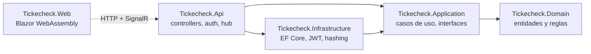
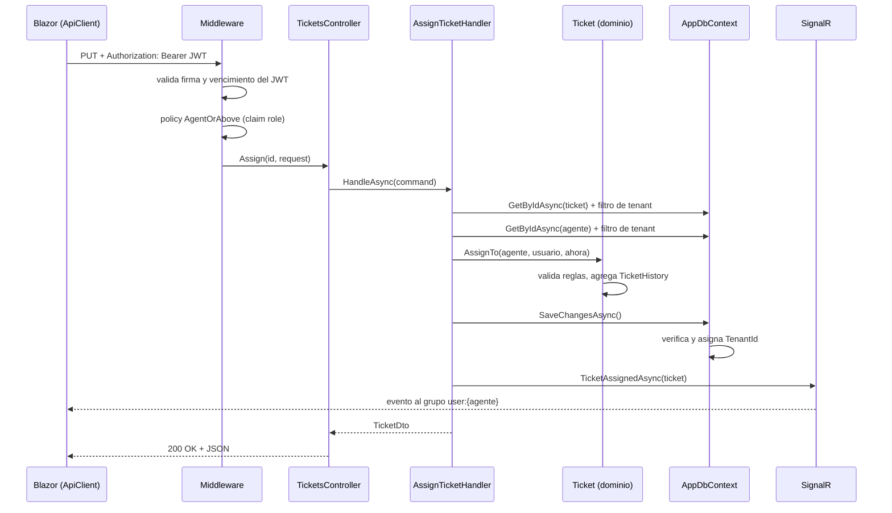
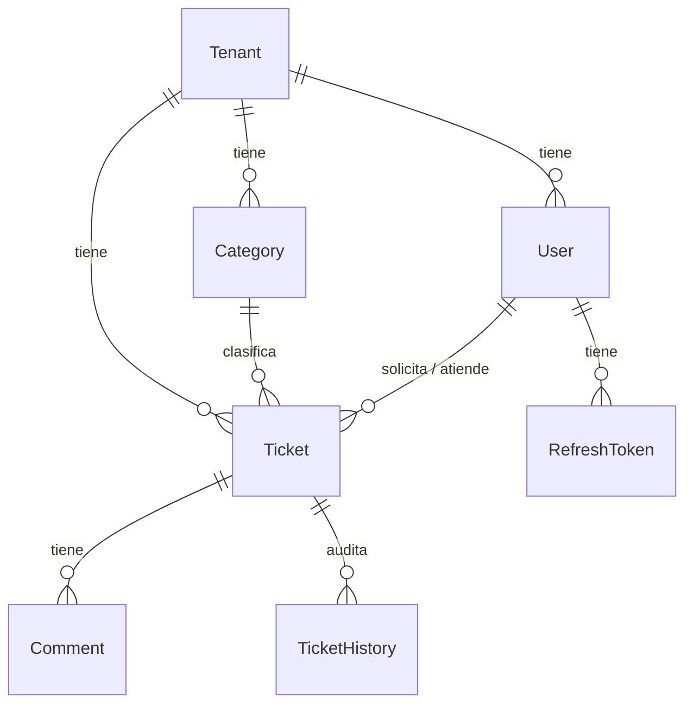

# Arquitectura

## 1. Capas

La solución sigue Clean Architecture. Las referencias entre proyectos apuntan solo hacia el
dominio, y el compilador lo hace cumplir.



| Proyecto | Responsabilidad | No conoce |
|---|---|---|
| **Domain** | Entidades (`Ticket`, `User`, ...), máquina de estados, SLA, auditoría, `DomainException` | EF Core, ASP.NET, cualquier paquete |
| **Application** | Un handler por caso de uso, validadores, DTOs, interfaces de lo que necesita (`ITicketRepository`, `ITenantProvider`, `ITokenService`, `ITicketNotifier`), reglas de visibilidad (`AccessRules`) | Base de datos, HTTP, SignalR |
| **Infrastructure** | `AppDbContext`, configuraciones y migraciones, repositorios, generación de JWT, hash de passwords, datos de demo | Controllers, HTTP |
| **Api** | Controllers, autenticación JWT, policies, manejo de errores, hub de SignalR, `Program.cs` | Reglas de negocio |
| **Web** | Páginas Blazor, cliente de la API, sesión, notificaciones | Los proyectos del backend (solo el contrato JSON) |

Api referencia a Infrastructure únicamente para registrar las implementaciones en el contenedor
de dependencias (`AddInfrastructure`). Ningún controller usa un tipo de Infrastructure.

### Inversión de dependencias

Application define la interfaz e Infrastructure la implementa:

```
Application:    interface ITicketRepository        CreateTicketHandler(ITicketRepository tickets)
Infrastructure: class TicketRepository : ITicketRepository   (usa AppDbContext)
Api:            services.AddScoped<ITicketRepository, TicketRepository>()
```

El handler nunca sabe que existe EF Core. En los tests unitarios recibe un repositorio simulado
con Moq; en producción, el real.

## 2. Una request de punta a punta

Ejemplo: un agente asigna un ticket. `PUT /api/tickets/{id}/assignee` con `{ "agentId": "..." }`.



Paso a paso, con el archivo donde ocurre cada cosa:

1. **Frontend** — `Web/Services/ApiClient.cs` agrega el header `Authorization: Bearer <token>`.
   Si el token está por vencer, antes lo renueva (`AuthService`).
2. **Autenticación** — el middleware JWT (`Api/Program.cs`) verifica firma, emisor y vencimiento
   y arma el usuario con sus claims. No consulta la base.
3. **Autorización** — `[Authorize(Policy = Policies.AgentOrAbove)]` sobre la acción. Un Requester
   recibe 403 acá y no se ejecuta nada más.
4. **Controller** — `Api/Controllers/TicketsController.cs` arma el comando con el Id de la URL y
   llama al handler. Nada más.
5. **Caso de uso** — `Application/Tickets/AssignTicket.cs`:
   - Carga el ticket. Si es de otra empresa, el filtro lo oculta y devuelve `null` → 404.
   - Carga el agente con el mismo filtro. Si no es de la empresa o no es staff → 400.
   - Llama a `ticket.AssignTo(...)`.
6. **Dominio** — `Domain/Tickets/Ticket.cs` rechaza la asignación si el ticket está cerrado, y si
   procede agrega un `TicketHistory` a su colección.
7. **Persistencia** — `SaveChangesAsync` pasa por `AppDbContext.EnforceTenantOnSave`, que asigna
   el `TenantId` al historial nuevo y verifica que nada pertenezca a otro tenant. El `UPDATE` del
   ticket y el `INSERT` del historial van en una transacción.
8. **Notificación** — `Api/Hubs/SignalRTicketNotifier.cs` envía `TicketAssigned` al grupo
   `user:{agentId}`.
9. **Respuesta** — el handler devuelve un `TicketDto` leído con una proyección SQL (con nombres
   de categoría y usuarios) y el controller responde 200.

Si algo lanza una excepción en cualquier paso, `Api/ErrorHandling/GlobalExceptionHandler.cs` la
convierte en una respuesta ProblemDetails.

## 3. Multi-tenancy

Modelo: base y esquema compartidos, columna `TenantId`
([ADR 0002](decisions/0002-tenant-por-columna.md)).

### De dónde sale el tenant

```
login → JWT con claim tenant_id (firmado por la API)
      → cada request trae el JWT
      → HttpTenantProvider lee el claim
      → AppDbContext lo usa en filtros y guardados
```

El cliente nunca envía el tenant como parámetro, header ni campo del body. Como el token está
firmado, no puede cambiar el claim sin invalidarlo.

### Las dos barreras (ambas en `Infrastructure/Persistence/AppDbContext.cs`)

**Lectura: Global Query Filters.** En `OnModelCreating`, a cada entidad que implementa
`ITenantEntity` se le registra:

```csharp
entity => CurrentTenantId != null && entity.TenantId == CurrentTenantId
```

EF Core agrega esa condición a todas las consultas de esa entidad, incluidos los `JOIN`. Un
repositorio escribe `db.Tickets.FirstOrDefaultAsync(t => t.Id == id)` y el SQL sale con
`AND TenantId = @tenant`.

**Escritura: `EnforceTenantOnSave`.** Antes de cada `SaveChanges`:

| Situación | Resultado |
|---|---|
| Fila nueva sin `TenantId` | Se le asigna el tenant actual |
| Fila nueva con el `TenantId` de otra empresa | `TenantViolationException` |
| Modificar o borrar una fila de otra empresa | `TenantViolationException` |
| Guardar datos de tenant sin tenant en contexto | `TenantViolationException` |

### Comportamiento según quién llama

| Quién | `tenant_id` | Qué ve |
|---|---|---|
| Usuario de una empresa | El de su empresa | Solo filas de su empresa |
| SuperAdmin | No tiene | Nada de las tablas filtradas; solo gestiona `Tenants` |
| Anónimo | No tiene | Nada |

### Excepciones al filtro

`IgnoreQueryFilters` aparece únicamente en `UserRepository`, en tres métodos con el sufijo
`IgnoringTenant`:

| Método | Lo usa | Por qué |
|---|---|---|
| `FindByEmailIgnoringTenantAsync` | Login | Aún no hay JWT ni tenant |
| `GetByIdIgnoringTenantAsync` | Refresh | Es una request anónima |
| `EmailExistsIgnoringTenantAsync` | Alta de usuario y de empresa | El email es único en toda la plataforma |

### Dentro de una misma empresa

El filtro de tenant no distingue roles. Lo que cada rol ve dentro de su empresa lo deciden las
policies y `AccessRules` ([ADR 0007](decisions/0007-autorizacion.md)).

### Cómo se prueba

- `tests/Tickecheck.IntegrationTests/Persistence/TenantIsolationTests.cs`: las dos barreras,
  directamente sobre el `DbContext`.
- `tests/Tickecheck.IntegrationTests/Api/TenantIsolationApiTests.cs`: un usuario de Acme intenta
  leer, listar, modificar, comentar y borrar datos de Globex por HTTP, con los Ids exactos.
- `tests/Tickecheck.IntegrationTests/Api/NotificationTests.cs`: los eventos de SignalR no cruzan
  de empresa.

## 4. Modelo de datos



`Category`, `Ticket`, `Comment` y `TicketHistory` implementan `ITenantEntity`. `User` tiene un
`TenantId` nullable y el mismo filtro. `Tenant` y `RefreshToken` no se filtran.

## 5. Endpoints

| Método y ruta | Policy | Caso de uso |
|---|---|---|
| `POST /api/auth/login`, `/refresh`, `/logout` | Anónimo | Sesión |
| `GET, POST /api/tenants` | SuperAdminOnly | Empresas |
| `GET /api/users` | AgentOrAbove | Listar usuarios |
| `POST /api/users` | TenantAdminOnly | Alta de usuario |
| `GET /api/categories` | TenantMember | Listar categorías |
| `POST /api/categories` | TenantAdminOnly | Alta de categoría |
| `GET /api/tickets` | TenantMember | Buscar con filtros, paginación y orden |
| `GET, PUT /api/tickets/{id}`, `POST /api/tickets` | TenantMember | Ver, editar, crear |
| `DELETE /api/tickets/{id}` | TenantAdminOnly | Borrar |
| `PUT /api/tickets/{id}/assignee`, `/status`, `/priority` | AgentOrAbove | Gestión |
| `POST /api/tickets/{id}/reopen` | TenantMember | Reabrir |
| `GET, POST /api/tickets/{id}/comments` | TenantMember | Comentarios |
| `GET /api/tickets/{id}/history` | TenantMember | Auditoría |
| `GET /api/dashboard` | AgentOrAbove | Estadísticas |
| `/hubs/notifications` | Autenticado | SignalR |
